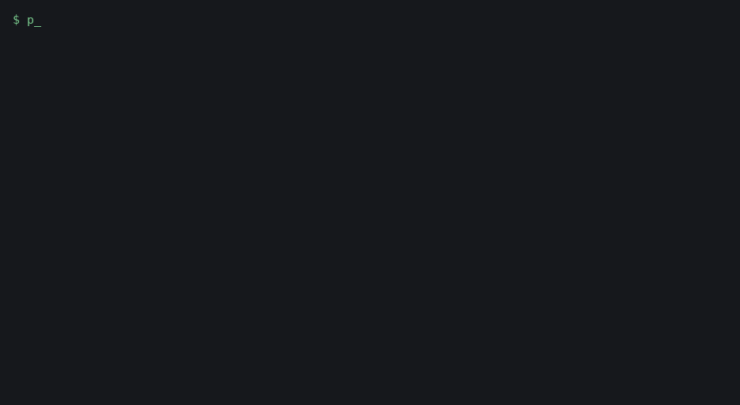

# V4Finder (v4finder)

Dérive ou découvre la ou les adresses IPv4 publiques associées à une adresse IPv6 publique.

**Principe** : cet outil ne devine jamais. Chaque résultat porte une méthode, un niveau de confiance et la preuve dont il a été dérivé. Pour une IPv6 résidentielle/mobile ordinaire sans PTR ni mécanisme de transition encodé, il n'y a simplement pas d'IPv4 à en dériver — l'outil le dit explicitement plutôt que d'en inventer une.




## Niveaux de confiance
| Niveau | Signification |
|---|---|
| `confirmed` | Confirmé dans les deux sens : l'AAAA de l'hôte repointe vers la cible |
| `deterministic` | L'IPv4 est mathématiquement intégrée dans l'IPv6 (6to4, Teredo, NAT64/RFC6052, ISATAP, 6rd, v4-mapped) |
| `strong` | Le même hôte répond dans les deux familles, mais pas de AAAA pour confirmer (PTR → A, SAN TLS → A) |
| `weak` | Même organisation, ou PTR contredit par sa propre AAAA — contexte seulement, jamais « l'» IPv4 |

## Usage
```
python3 v4finder.py 2001:db8::1
python3 v4finder.py 2001:db8::1 --tls --rdap-netblocks
echo 2001:db8::1 | python3 v4finder.py --stdin --json
python3 v4finder.py 2001:db8::1 --offline          # analyse structurelle seule, sans réseau
```

## Options principales
| Option | Rôle |
|---|---|
| `address` | Adresse IPv6 publique à résoudre |
| `--stdin` | Lire les adresses depuis stdin |
| `--offline` | Analyse structurelle seule, sans réseau |
| `--tls` | Se connecte à la cible et lit les SAN du certificat (touche la cible) |
| `--rdap-netblocks` | Liste aussi les netblocks IPv4 de la même organisation (confiance faible) |
| `--no-verify` | Passe la confirmation par DNS inverse |
| `--resolver` | Serveurs DNS à interroger (nécessite dnspython) |
| `--trace` | Affiche les requêtes DNS et les temps par stratégie |
| `--only` / `--skip` | Limiter ou exclure des stratégies |
| `--json` | Sortie machine |

**Tests** : `python3 test_v4finder.py` (hors ligne, résolveur DNS simulé).
